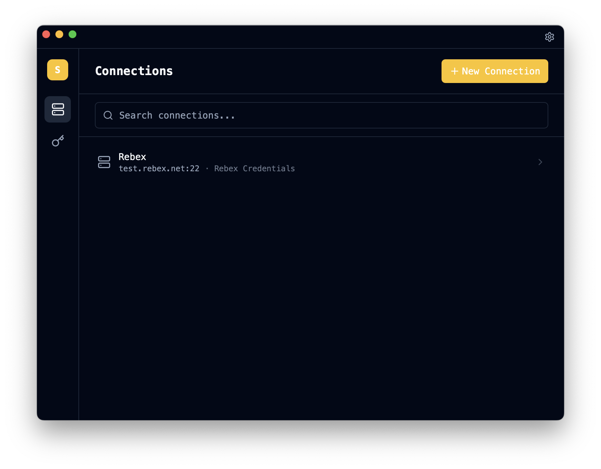

# SSIX — SSH Client

[](https://github.com/gregorybarille/ssix/actions/workflows/test.yml)

SSIX is a desktop SSH client built with Tauri, React, and Rust. It combines saved SSH connections, reusable credentials, tabbed and split terminals, port forwards, SCP transfers, diagnostics, screenshots, and Git-backed config sync in one app.



## Highlights

- Direct SSH, jump host (`ssh -J`), and local, remote and dynamic forward (`ssh -L`, `-R`, `-D`) connections
- Host aliases from `~/.ssh/config` work when connecting, and whole hosts can be imported from it
- Saved credentials with password, key-path, and inline-key support
- Terminal tabs and split panes
- SCP upload/download, including recursive directory transfer
- Logs, screenshots, search, tags, and connection colors
- Sanitized Git sync with diff, commit, and one-click sync

## Install

Prerequisites:

- Rust stable
- Node.js 22.12+
- npm 9+

```bash
git clone https://github.com/gregorybarille/ssix
cd ssix
npm install
npm run tauri build
```

## Development

```bash
npm install
npm run tauri dev
npm test
cd src-tauri && cargo test
```

## Quick Start

1. Create a credential or use inline auth in the connection form.
2. Create a connection: direct, jump host, or a local, remote or dynamic forward.
3. Connect from the Connections view.
4. Optionally set `login_command` and `remote_path` on the connection.
5. Use `Transfer files` for SCP or `Git Sync` for sanitized config sync.

## Documentation

- [Features](docs/features.md)
- [Architecture](docs/architecture.md)
- [Development](docs/development.md)
- [Git Sync](docs/git-sync.md)
- [File Transfer](docs/file-transfer.md)
- [Import from SSH config](docs/ssh-config-import.md)
- [Troubleshooting](docs/troubleshooting.md)

## Storage

- Runtime config: `~/.ssix/data.json`
- Secrets: `~/.ssix/secrets.json`
- Optional Git export: `.ssix-sync/` inside your configured sync repository

## License

MIT
